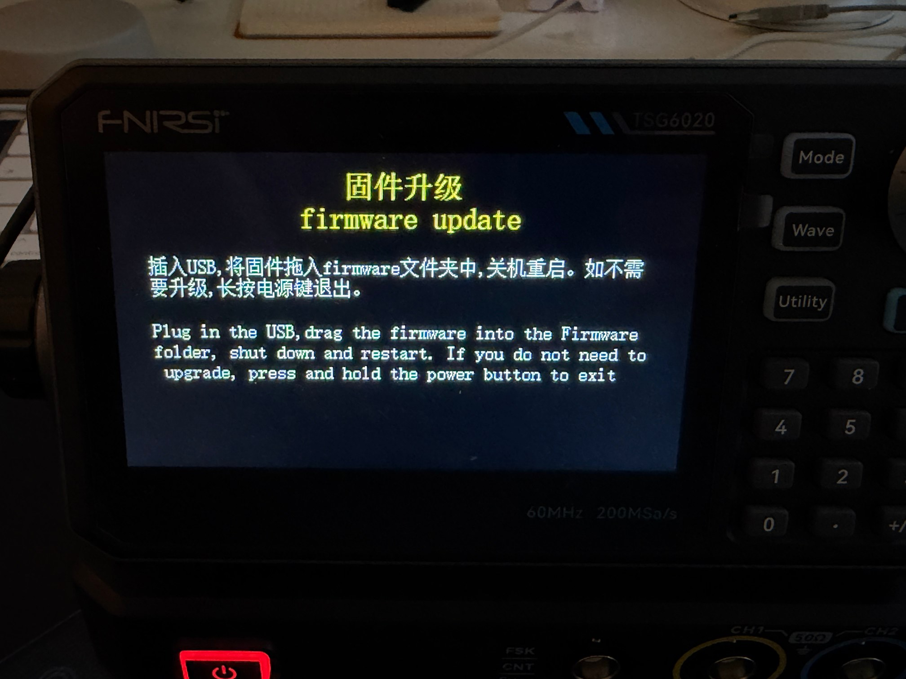
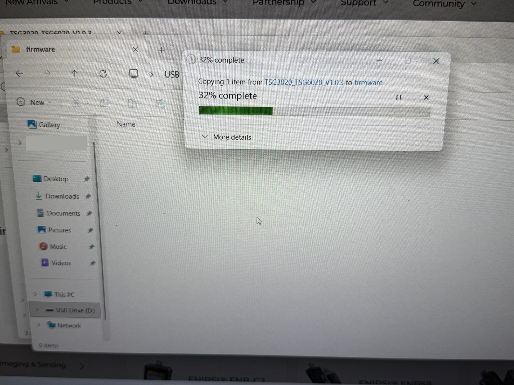
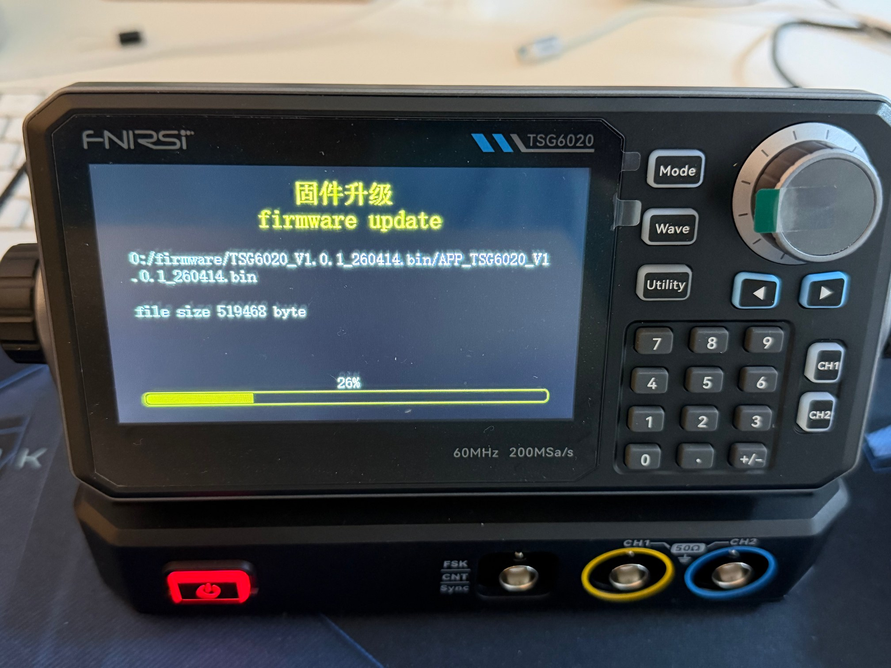
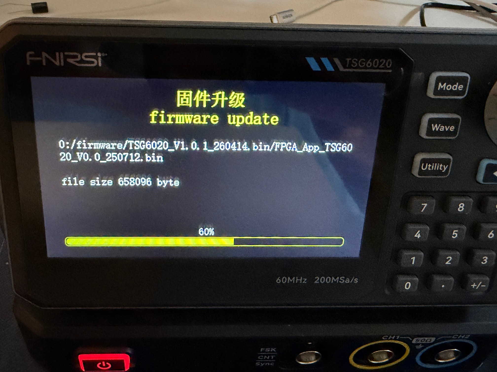
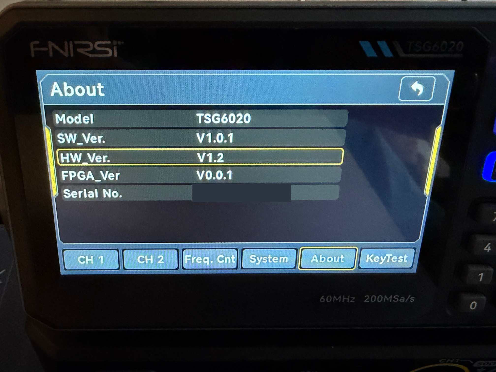
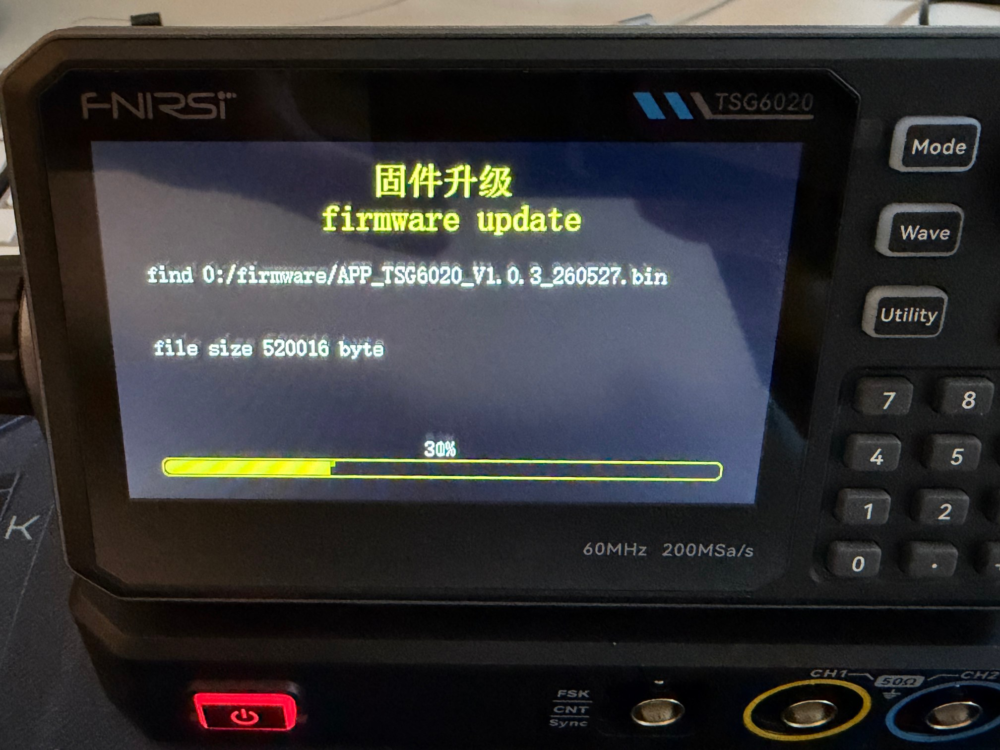
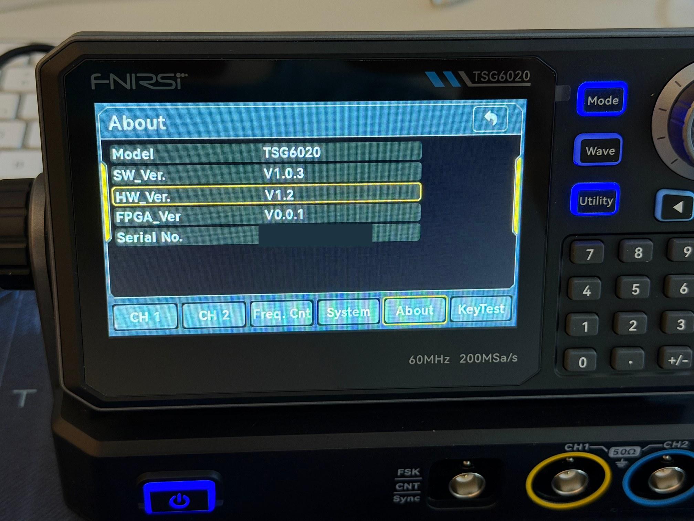

# FNIRSI TSG6020 / TSG3020 – firmware update & PC control notes

Unofficial community notes for the **FNIRSI TSG6020** (60 MHz) and **TSG3020** (30 MHz) dual-channel function / arbitrary waveform generators.

FNIRSI publishes firmware for these models but, at the time of writing, no update tool or update tutorial. This repository documents the procedure that worked on a TSG6020, plus what we found about controlling it from a PC.

> ⚠️ Flashing firmware is at your own risk. Use the official files only and read the whole guide first.

- [Firmware update](#firmware-update)
- [Firmware versions](#firmware-versions)
- [PC control (SCPI)](#pc-control-scpi)
- [Türkçe özet](#türkçe-özet)

---

## Firmware update

### What you need

- A **Windows 10/11 PC**. Do **not** use macOS for flashing: FNIRSI warns it can make the device unresponsive or brick it.
- The **USB data cable** supplied with the generator (USB-B on the rear panel). A charge-only cable won't work.
- A **power source that won't drop during the update** (see below).
- The official firmware from FNIRSI: [Manuals & Firmwares → TSG3020 / TSG6020](https://www.fnirsi.com/pages/manuals-firmwares?category=signal-analysis). Extract the zip before you start.

### Power: keep the generator powered no matter what

An interrupted flash can damage the device. The TSG is powered over USB-C (5 V / 2 A), so you can feed it from a source that keeps running during a mains power cut:

- **A laptop's USB-C port** that can deliver enough power. If the mains fails, the laptop runs on battery and keeps powering the generator for the whole update.
- **An external power bank** (5 V / 2 A or better) works just as well.

Avoid a wall adapter on its own if your mains is unreliable.

### Steps

1. **Enter update mode:** with the generator off, **press and hold the multifunction knob** and power it on. A `固件升级 / firmware update` screen appears.

   

2. **Connect to the PC:** plug the rear USB port into the Windows PC with the data cable. The generator shows up as **`USB Drive`** with a **`firmware`** folder.
3. **Copy the firmware:** copy the `.bin` file into the `firmware` folder.

   

4. **Restart to flash:** hold the power button for about **3 seconds** to switch off, then power on again. The bootloader finds the file, flashes it and shows a progress bar. Don't disconnect anything until it finishes.

   

5. **Check the version:** `Utility → System → About` → `SW_Ver.` If you enter update mode again, the `firmware` folder will be empty: the bootloader deletes the file after flashing it.
6. **Optional:** factory reset with `Utility → System → Factory Set`.

To leave update mode **without** flashing, press and hold the power button.

### Install V1.0.1 first, then V1.0.3

The two packages are not the same kind of file:

| File | Size | Contents |
|---|---|---|
| `TSG6020_V1.0.1_260414.bin` | 1.18 MB | **Bundle**: application `APP_TSG6020_V1.0.1_260414.bin` **+ FPGA image** `FPGA_App_TSG6020_V0.0_250712.bin` |
| `APP_TSG6020_V1.0.3_260527.bin` | 520 KB | Application only |

When you flash V1.0.1 the bootloader unpacks the bundle and writes both parts:



Because only the V1.0.1 package carries the FPGA image, the safe path from factory firmware is:

1. Flash **V1.0.1**, check `About` shows `V1.0.1`.

   

2. Enter update mode again, copy **V1.0.3** into the `firmware` folder and restart. No cleanup is needed: after a successful flash the bootloader removes the file, so the folder is empty again.

   
   

**FPGA version note:** `About → FPGA_Ver` showed `V0.0.1` before the update, after V1.0.1 and after V1.0.3 plus a factory reset. The bundled FPGA image is probably the same version that ships from the factory. FNIRSI hasn't documented this.

---

## Firmware versions

From FNIRSI's changelogs:

| Version | Date | Change |
|---|---|---|
| V1.0.3 | 2026-05-27 | Fixes intermittent touch failure |
| V1.0.1 | 2026-03-31 | Key test screen: "Mave" corrected to "Wave" (package also contains the FPGA image) |

No new features were added in either release.

The firmware files are **not** included in this repository. Download them from FNIRSI's official page linked above.

---

## PC control (SCPI)

FNIRSI doesn't document any PC control for this model, but:

- In **normal mode** (not update mode), the generator appears on the PC as a **USB serial port** (e.g. `COM5` on Windows, `/dev/cu.usbserial-…` / `/dev/cu.usbmodem…` on macOS).
- It **answers SCPI queries**, including `*IDN?`.

The full command set is still being explored. The TSG user manual references UNI-T's **UTG932 / UTG962** in its spec tables, and those generators have the same headline specs. Their [UTG900E programming manual](https://events.uni-trend.com/hubfs/Instrument%20Product%20documentation/Waveform%20Generators/UTG900E/UTG900E%20Programming%20Manual%20V1.0.pdf) (`:CHANnel1:BASE:FREQuency 1000`, `:CHANnel1:OUTPut ON`, …) is a good first guess. **This is not verified on the TSG yet.**

### Tools

Both scripts send **queries only** and change no settings.

```bash
pip install pyserial pyvisa pyvisa-py pyusb libusb-package

# 1. find the port and check that the generator answers *IDN?
python3 tools/tsg_scpi_probe.py                         # all ports
python3 tools/tsg_scpi_probe.py /dev/cu.usbserial-XXXX  # one port

# 2. see which SCPI dialect it understands (UNI-T, generic SCPI, Siglent, counter)
python3 tools/tsg_scpi_explore.py /dev/cu.usbserial-XXXX
```

Results from other users are welcome. Please open an issue with the explorer output.

---

## Türkçe özet

**Güncelleme modu:** Cihaz kapalıyken çok fonksiyonlu düğmeye basılı tutup açın.

**Güç:** Güncelleme sırasında elektrik kesilirse cihaz da kapanmasın. Cihazı yeterli güç veren bir laptop USB-C portundan ya da powerbank'ten besleyin.

**Adımlar:**
1. Windows bilgisayarı veri kablosuyla bağlayın. Cihaz `USB Drive` olarak görünür.
2. `.bin` dosyasını `firmware` klasörüne kopyalayın.
3. Güç tuşuna yaklaşık 3 saniye basılı tutarak kapatın, sonra yeniden açın. Güncelleme otomatik başlar.
4. `Utility → System → About` ekranından sürümü kontrol edin. Güncelleme bitince dosya otomatik silinir, `firmware` klasörü yeniden boş görünür.

**Sıra:** Önce V1.0.1'i yükleyin, çünkü FPGA dosyası yalnızca bu pakette var. Sonra aynı yöntemle V1.0.3'ü yükleyin. Güncelleme için Mac kullanmayın.

**PC kontrolü:** Cihaz normal modda seri port olarak görünüyor ve SCPI komutlarına cevap veriyor. Komut seti henüz araştırılıyor.

---

*Tested on: TSG6020, HW V1.2, factory firmware → V1.0.1 → V1.0.3. The TSG3020 uses the same firmware package but hasn't been tested.*

*Not affiliated with FNIRSI. Product names are trademarks of their respective owners.*
